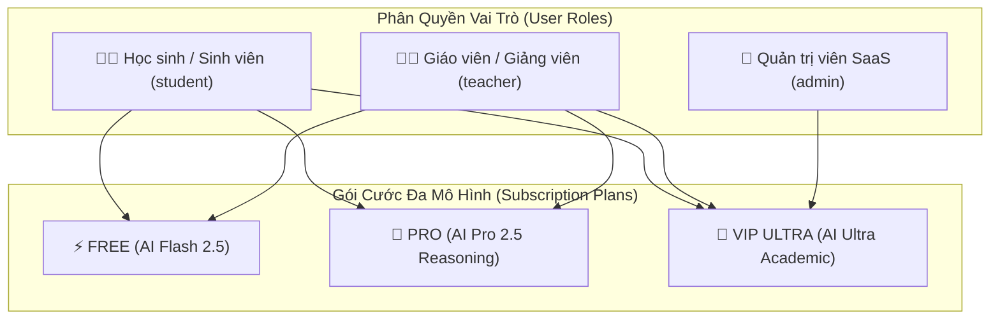
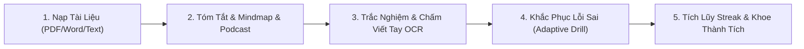
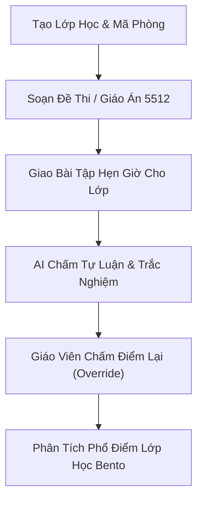
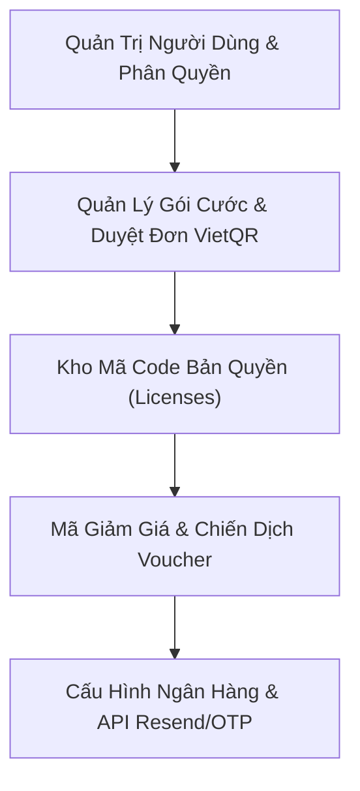

# 📘 BÁO CÁO TOÀN DIỆN VỀ KIẾN TRÚC PHÂN QUYỀN & TẤT CẢ CHỨC NĂNG THEO TỪNG VAI TRÒ (ROLES)
### Nền tảng EdTech AI All-in-One: **AI Study Assistant Pro**
*Ngày xuất bản: 08/11/2026 • Phiên bản hệ thống: v2.5 Commercial Suite*

---

## 📑 MỤC LỤC
1. [TỔNG QUAN KIẾN TRÚC PHÂN QUYỀN (RBAC) & GÓI CƯỚC](#1-tổng-quan-kiến-trúc-phân-quyền-rbac--gói-cước)
2. [VAI TRÒ 1: HỌC SINH / SINH VIÊN (`student`)](#2-vai-trò-1-học-sinh--sinh-viên-student)
3. [VAI TRÒ 2: GIÁO VIÊN / GIẢNG VIÊN (`teacher`)](#3-vai-trò-2-giáo-viên--giảng-viên-teacher)
4. [VAI TRÒ 3: QUẢN TRỊ VIÊN HỆ THỐNG / CHỦ SAAS (`admin`)](#4-vai-trò-3-quản-trị-viên-hệ-thống--chủ-saas-admin)
5. [MA TRẬN SO SÁNH QUYỀN LỢI CHI TIẾT (ROLE VS FEATURE MATRIX)](#5-ma-trận-so-sánh-quyền-lợi-chi-tiết-role-vs-feature-matrix)
6. [ĐỊNH HƯỚNG MỞ RỘNG THƯƠNG MẠI HÓA](#6-định-hướng-mở-rộng-thương-mại-hóa)

---

## 1. TỔNG QUAN KIẾN TRÚC PHÂN QUYỀN (RBAC) & GÓI CƯỚC

Hệ thống **AI Study Assistant** vận hành dựa trên cơ chế **Phân quyền dựa trên Vai trò 2 tầng (Two-Tier RBAC & Subscription Architecture)**:
* **Tầng 1 - Vai trò Người dùng (User Roles):** Quyết định chức năng nghiệp vụ học tập hay giảng dạy hay quản trị hệ thống.
  * `student`: Học sinh / Sinh viên.
  * `teacher`: Giáo viên / Giảng viên.
  * `admin`: Quản trị viên tối cao (Chủ dự án SaaS).
* **Tầng 2 - Gói cước Bản quyền (Subscription Plans):** Quyết định năng lực mô hình AI và hạn mức tính năng.
  * `free`: Gói miễn phí cơ bản (Sử dụng AI Flash 2.5 tốc độ cao).
  * `pro`: Gói chuyên nghiệp (AI Pro 2.5 Suy luận CoT, Chấm OCR bài viết tay, Mindmap & Podcast không giới hạn).
  * `vip`: Gói học thuật cao cấp (AI Ultra Academic, Soạn Giáo án 5512, Đề thi HSG, Xuất Word/Excel không giới hạn).

---

## 2. VAI TRÒ 1: HỌC SINH / SINH VIÊN (`student`)

Vai trò trọng tâm của người học, được thiết kế xoay quanh chu trình: **Tiếp nhận tài liệu ➔ Phân tích thông minh ➔ Ôn thi khảo thí ➔ Đo lường tiến độ ➔ Động lực Gamification**.

### 2.1. Quản lý Tài khoản & Định danh Cá nhân
* **Đăng ký tài khoản có xác thực Email OTP:** Nhận mã 6 số gửi tự động về hòm thư, loại bỏ tài khoản ảo.
* **Đăng nhập an toàn:** Cơ chế băm mật khẩu `scrypt` với muối ngẫu nhiên (salt) chuẩn bảo mật ngân hàng.
* **Quên mật khẩu tự phục vụ qua Email:** Không cần liên hệ kỹ thuật viên; nhập email/tên đăng nhập ➔ nhận mã OTP xác thực ➔ đặt lại mật khẩu mới.
* **Đổi mật khẩu chủ động:** Thực hiện ngay trong cài đặt hồ sơ.

### 2.2. Tiếp nhận & Xử lý Tài liệu Học tập Đa Nguồn
* **Tải tệp đa định dạng:** Hỗ trợ tải lên tài liệu PDF, tài liệu Word (`.docx`), và tệp hình ảnh (`.png`, `.jpg`, `.webp`).
* **Học từ dán văn bản trực tiếp / Nhập chủ đề nhanh:** Không bắt buộc phải có tệp PDF; học sinh chỉ cần copy một bài viết trên mạng hoặc nhập chủ đề (ví dụ: *"Định luật Ôm trong Vật lý 11"*), hệ thống tự động khởi tạo không gian học tập tức thì.
* **Tủ sách cá nhân (Document Library):** Tự động lưu trữ lịch sử học tập, thời gian mở lần cuối, tìm kiếm tài liệu theo từ khóa, tải lại bài học chỉ với 1 cú nhấp chuột.
* **Xem tài liệu gốc song song (Split-View):** Trên Desktop/Tablet, màn hình chia 2 cột: bên trái đọc PDF/Word gốc, bên phải tương tác với AI.

### 2.3. Không Gian Học Tập Tương Tác AI (AI Learning Studio)
* **Tóm tắt chuyên sâu (Auto Summary):** 
  - Tóm tắt tổng quan (Executive Summary).
  - Điểm cốt lõi cần nhớ (Key Takeaways).
  - Thuật ngữ chuyên ngành then chốt (Glossary).
* **Sơ đồ tư duy trực quan (Interactive Mindmap):** Chuyển toàn bộ bài đọc thành cây sơ đồ tư duy có thể co giãn, phóng to, thu nhỏ và khám phá từng nút kiến thức.
* **AI Podcast 2 Giọng đọc (NotebookLM Audio Discussion Style):** Tự động tạo kịch bản đối thoại sinh động giữa 2 chuyên gia học thuật (nam/nữ) bàn luận về tài liệu, tích hợp trình phát âm thanh trực tiếp.
* **Thẻ ghi nhớ không gian 3D (Flashcards 3D):** Lật thẻ 3 chiều với hiệu ứng chuyển cảnh mượt mà, hỗ trợ học từ vựng tiếng Anh, công thức Toán, Lý, Hóa theo phương pháp lặp lại ngắt quãng (Spaced Repetition).
* **Trợ lý AI Gia sư 24/7 (Document RAG Chat & General Tutor):** 
  - Hỏi đáp trực tiếp dựa trên ngữ cảnh tài liệu vừa nạp (không lo AI bịa đặt / ảo giác kiến thức).
  - Hỗ trợ đổi mô hình AI linh hoạt: **Flash 2.5** (siêu tốc), **Pro 2.5** (suy luận chuyên sâu từng bước), **Ultra** (chuyên gia học thuật).

### 2.4. Hệ Thống Khảo Thí, Luyện Thi & Chấm Bài Đột Phá
* **Làm bài Trắc nghiệm AI:**
  - Tùy chọn ma trận 3 mức độ: Cơ bản (nắm gốc), Chuẩn Bộ GD&ĐT (4 mức độ), Vận dụng cao (8+ / HSG).
  - Tự động xáo trộn câu hỏi và các phương án A, B, C, D để chống ghi nhớ máy móc.
  - Chấm điểm tức thì thang điểm 10 kèm lời giải thích chi tiết từng câu.
* **Luyện tập Thích ứng 1-Click (Adaptive Weakness Drill):**
  - Sau khi làm bài, nếu có câu sai, hệ thống cung cấp nút *"Luyện khắc phục các câu vừa sai"*. AI sẽ phân tích lỗ hổng kiến thức và tạo ngay đề mới tập trung đúng vào điểm yếu của học sinh.
* **Giám sát chống gian lận thi cử (Anti-Cheat Proctoring):**
  - Tự động phát hiện và đếm số lần học sinh chuyển tab sang trình duyệt khác để tra Google.
  - Hiển thị thanh cảnh báo đỏ nhấp nháy, ghi nhận lịch sử vi phạm nộp về cho giáo viên.
  - Vô hiệu hóa tính năng bôi đen copy câu hỏi thi.
* **Luyện viết Tự luận & Chấm bài qua Ảnh Viết tay (OCR Handwriting Grading):**
  - Học sinh nhập bài luận trực tiếp hoặc dùng điện thoại chụp ảnh bài giải viết tay trong vở.
  - Công nghệ AI OCR nhận diện nét chữ, chấm điểm theo Rubric, chỉ ra lỗi ngữ pháp, lỗi logic và gợi ý cách sửa cụ thể.

### 2.5. Động Lực Học Tập & Gamification 2.0
* **Chuỗi ngày học liên tục (Streak):** Đếm số ngày vào học đều đặn, hiển thị biểu tượng ngọn lửa rực cháy trên thanh tiêu đề.
* **Điểm kinh nghiệm (XP):** Mỗi bài làm xong, mỗi tài liệu đọc xong đều được cộng điểm XP.
* **Bảng Vàng Vinh Danh (Leaderboard):** Xem bục vinh danh Top 1, 2, 3 và thứ hạng của bản thân so với toàn bộ học sinh trên hệ thống.
* **Thẻ Thành Tích Khoe Lên Mạng Xã Hội (Viral Social Card Generator):** Khi đạt điểm giỏi (≥ 7.5/10), học sinh có thể xuất ngay **Thẻ chứng nhận Story độ nét cao (1080x1350)** hoặc copy link để đăng lên Zalo/Facebook khoe với bạn bè.

### 2.6. Trợ Năng & Năng Suất Học Sâu
* **Chế độ Học Tập Tập Trung (Zen Focus Mode):** 1-chạm ẩn sạch Header, Sidebar và các công cụ thừa, chỉ còn tài liệu toàn màn hình không xao nhãng.
* **Đồng hồ Pomodoro & Âm thanh Sóng Não Alpha (Pomodoro Player):**
  - Đếm ngược chu kỳ 25 phút tập trung / 5 phút nghỉ ngơi.
  - Bộ phát sóng não Alpha (10Hz Binaural Beats), Tiếng mưa rơi (Raindrops), Sóng biển (Ocean Waves) tạo trực tiếp từ trình duyệt bằng Web Audio API (không tốn dung lượng tải, chạy mượt cả khi mất mạng).
* **Cài đặt Ứng dụng PWA 1-Chạm:** Cài trực tiếp lên màn hình chính điện thoại iPhone / Android, mở lên như app tải từ App Store.

### 2.7. Gói Cước, Thanh Toán & Chăm Sóc Khách Hàng
* **Nâng cấp gói qua VietQR động:** Hiển thị mã QR ngân hàng tự điền đúng số tiền và nội dung chuyển khoản.
* **Hệ thống Mã Giảm Giá (Coupon/Voucher):** Nhập mã ưu đãi (ví dụ: `CHAOHOC2026`, `VIPPRO50K`) để trừ tiền tức thì và cập nhật lại mã VietQR ngay trên màn hình.
* **Nhập mã kích hoạt (License Code):** Kích hoạt nhanh gói Pro/VIP khi nhận mã từ trường hoặc quà tặng.
* **Thanh thông báo cảnh báo sắp hết hạn:** Báo trước 3 ngày để học sinh gia hạn, giữ nguyên ưu đãi và dữ liệu.
* **Hỗ trợ Zalo CSKH 24/7 (`0923678668`):** Nằm trang trọng trong tab Cá nhân, menu Avatar và Sidebar, cam kết hỗ trợ trong 5 phút & hoàn tiền 100% trong 3 ngày.

---

## 3. VAI TRÒ 2: GIÁO VIÊN / GIẢNG VIÊN (`teacher`)

Giáo viên sở hữu **toàn bộ các chức năng học tập của học sinh**, đồng thời được trang bị **bộ công cụ trợ giảng, quản lý lớp học và khảo thí tự động chuyên sâu**.

### 3.1. Quản Trị Lớp Học & Quản Lý Học Sinh
* **Khởi tạo phòng học với Mã Lớp độc nhất (Class Code):** Giáo viên tạo lớp (ví dụ: *12A1 - Toán Thầy Hùng*), hệ thống cấp mã 6 ký tự để phát cho học sinh tham gia.
* **Quản lý danh sách thành viên:** Xem danh sách học sinh đã vào lớp, phê duyệt hoặc xóa học sinh ra khỏi lớp.
* **Chẩn đoán tình hình học tập lớp (Class Diagnostic Panel):** Phân tích tự động điểm số trung bình của từng học sinh để phát hiện học sinh yếu kém cần phụ đạo sớm.

### 3.2. Trợ Lý Soạn Giáo Án Chuẩn Công Văn 5512 Bộ GD&ĐT
* Tự động tạo giáo án từ tài liệu bài giảng hoặc chuyên đề nạp vào.
* Đúng chuẩn quy định của Bộ Giáo dục & Đào tạo gồm 4 phần cốt lõi:
  1. **Mục tiêu bài học** (Kiến thức, Năng lực, Phẩm chất).
  2. **Thiết bị dạy học và học liệu**.
  3. **Tiến trình dạy học** (Hoạt động 1: Mở đầu; Hoạt động 2: Hình thành kiến thức; Hoạt động 3: Luyện tập; Hoạt động 4: Vận dụng).
  4. **Hướng dẫn tự học ở nhà**.

### 3.3. Soạn Đề Thi, Ma Trận 4 Mức Độ & Giao Bài Kiểm Tra
* **Tạo đề thi trắc nghiệm theo chuẩn ma trận:** Tùy biến số lượng câu hỏi và tỷ lệ phân bổ: Nhận biết (40%), Thông hiểu (30%), Vận dụng (20%), Vận dụng cao (10%).
* **Xuất bản đề thi ra file Word (`.docx`) & In đề A4:**
  - 1-chạm xuất đề thi chuẩn thể thức Word kèm bảng đáp án ở cuối trang để in ấn phát đề trên lớp.
  - Hỗ trợ in trực tiếp khổ giấy A4 chuẩn form kiểm tra trường học.
* **Giao bài kiểm tra có hẹn giờ (Assignment Dispatcher):**
  - Giao bài kiểm tra Trắc nghiệm hoặc Tự luận cho một lớp cụ thể.
  - Đặt thời gian mở đề (`startTime`) và thời hạn chót nộp bài (`endTime`).
  - Học sinh nộp sau thời hạn sẽ bị khóa tự động.

### 3.4. Hệ Thống Chấm Bài Tự Động & Chấm Bài Viết Tay
* **Chấm trắc nghiệm tự động 100%:** Ngay khi học sinh nộp bài, hệ thống chấm điểm theo thang điểm 10, tính toán số câu đúng/sai và lưu lịch sử.
* **Chấm tự luận bằng AI kết hợp OCR:** Chấm tự luận văn học, tiếng Anh, bài giải Toán từ bản gõ hoặc ảnh chụp bài làm học sinh nộp lên.
* **Quyền Can Thiệp & Sửa Điểm Của Giáo Viên (Teacher Score Override):**
  - Giáo viên có quyền xem lại toàn bộ bài làm của học sinh.
  - Giáo viên có thể nhập lại điểm số thủ công nếu muốn cộng điểm sáng tạo hoặc trừ điểm lỗi trình bày.
  - Ghi lời nhận xét (Teacher's remarks) gửi riêng cho từng học sinh.

### 3.5. Bảng Phân Tích Phổ Điểm & Thống Kê Học Tập (Bento Analytics)
* **Bảng điều khiển kết quả lớp học thời gian thực:**
  - Tổng số bài nộp của lớp.
  - Điểm trung bình lớp (GPA).
  - Tỷ lệ Đạt (≥ 5.0), Tỷ lệ Thi lại (3.0 – 4.9), Tỷ lệ Chưa đạt (< 3.0).
* **Biểu đồ Phổ Điểm Lớp Học:** Trực quan hóa tỷ lệ phần trăm phân bổ điểm số bằng thanh biểu đồ màu sắc sinh động (Xanh lá - Vàng - Đỏ).
* **Xem chi tiết bài làm của từng cá nhân:** Bấm vào học sinh để xem chi tiết học sinh đó làm đúng câu nào, sai câu nào, chọn đáp án gì và vi phạm chuyển tab bao nhiêu lần.

---

## 4. VAI TRÒ 3: QUẢN TRỊ VIÊN HỆ THỐNG / CHỦ SAAS (`admin`)

Dành riêng cho **Chủ sở hữu nền tảng**, sở hữu quyền hạn tối cao trong việc điều hành kinh doanh, quản lý người dùng, phân phối mã kích hoạt và cấu hình tài chính.

### 4.1. Bảng Điều Khiển Kinh Doanh & Vận Hành (Super Admin Dashboard)
* **Chỉ số kinh doanh tổng quan:**
  - Tổng số người dùng đăng ký.
  - Số lượng Giáo viên (`teachers`) và Học sinh (`students`).
  - Số lượng người dùng trả phí (Tách riêng gói Pro và gói VIP).
  - Doanh thu ước tính thời gian thực (Estimated Revenue VND).
  - Số lượng cuộc gọi API AI tiêu thụ trong ngày để kiểm soát chi phí hạ tầng.
  - Số đơn hàng đăng ký đang chờ duyệt.

### 4.2. Quản Lý Người Dùng & Phân Quyền Toàn Năng
* **Tìm kiếm & Lọc người dùng:** Tìm tức thì theo tên đăng nhập, họ tên, email hoặc vai trò.
* **Nâng/Hạ cấp vai trò (Role Modification):** Chuyển đổi nhanh bất kỳ tài khoản nào giữa `student`, `teacher`, và `admin`.
* **Cấp phát & Thay đổi gói cước thủ công:** Gán gói `pro` hoặc `vip`, tùy chỉnh số ngày sử dụng cho khách hàng VIP mà không cần nạp tiền.
* **Xóa tài khoản:** Xóa bỏ các tài khoản vi phạm chính sách hoặc tài khoản rác.

### 4.3. Động Cơ Quản Trị & Phát Hành Mã Bản Quyền (License Code Engine)
* **Phát hành mã Code hàng loạt (Batch Generation):**
  - Chọn loại gói: Gói PRO hoặc Gói VIP.
  - Chọn thời hạn: 30 ngày, 90 ngày, 1 năm (365 ngày) hoặc Vĩnh viễn.
  - Tạo một lúc 1 mã hoặc 10, 50, 100 mã để bán sỉ cho trường học / trung tâm luyện thi.
  - Gán mã theo Email đối tác nhận quà.
* **Quản lý vòng đời mã Code:**
  - Danh sách mã đã phát hành kèm trạng thái: *Chưa sử dụng* hoặc *Đã kích hoạt*.
  - Xem rõ ai là người đã kích hoạt mã, vào ngày giờ nào.
  - Nút sao chép mã 1-chạm gửi cho khách hàng.

### 4.4. Quản Lý Đơn Hàng & Cấu Hình Cổng Thanh Toán VietQR
* **Quản lý đơn hàng nâng cấp gói:** Danh sách đơn hàng chuyển khoản từ học sinh trên toàn hệ thống.
* **Chế độ duyệt đơn linh hoạt (Approval Modes):**
  - **Duyệt tự động tức thì (Instant Mode):** Tự động kích hoạt ngay gói cước cho học sinh khi hệ thống nhận diện giao dịch.
  - **Duyệt thủ công (Manual Review):** Admin kiểm tra biến động số dư ngân hàng rồi bấm duyệt kích hoạt bằng tay.
* **Cấu hình tài khoản nhận tiền ngân hàng:**
  - Tùy chỉnh trực tiếp trên giao diện: Mã ngân hàng (MB, Vietcombank, Techcombank, ACB...), Số tài khoản nhận tiền, Tên chủ tài khoản.
  - Toàn bộ ảnh VietQR trên toàn hệ thống sẽ tự động cập nhật theo tài khoản của Admin.

### 4.5. Quản Lý Mã Khuyến Mãi (Voucher & Discount Coupons)
* Thiết lập các mã giảm giá cho chiến dịch tiếp thị (như `CHAOHOC2026`, `VIPPRO50K`).
* Cấu hình số tiền giảm giá trực tiếp (trừ 50.000đ) hoặc theo phần trăm (trừ 20%, 30%).
* Thiết lập số lượng kích hoạt tối đa và ngày hết hạn mã.

### 4.6. Cấu Hình Hạ Tầng, Bảo Mật & Email OTP
* **Quản lý kết nối Email OTP:** Tích hợp Resend API hoặc Google Apps Script Webhook để gửi mã xác thực đăng ký và quên mật khẩu.
* **Bảo vệ toàn vẹn dữ liệu:** Tự động đồng bộ cơ sở dữ liệu đám mây thời gian thực, lưu trữ dự phòng lịch sử thi và bài nộp.

---

## 5. MA TRẬN SO SÁNH QUYỀN LỢI CHI TIẾT (ROLE VS FEATURE MATRIX)

| Danh Mục Chức Năng | Học Sinh (`student`) | Giáo Viên (`teacher`) | Quản Trị Viên (`admin`) |
| :--- | :---: | :---: | :---: |
| **Đăng ký / Đăng nhập / Quên mật khẩu qua Email OTP** | ✅ | ✅ | ✅ |
| **Nạp file PDF, Word, Ảnh & Dán bài học trực tiếp** | ✅ | ✅ | ✅ |
| **Tự động Tóm tắt thông minh & Mindmap** | ✅ | ✅ | ✅ |
| **AI Podcast 2 Giọng Đọc (NotebookLM Style)** | ✅ | ✅ | ✅ |
| **Flashcards 3D tương tác lật thẻ** | ✅ | ✅ | ✅ |
| **Hỏi đáp AI theo tài liệu & Gia sư tổng quát** | ✅ | ✅ | ✅ |
| **Tạo & Làm bài trắc nghiệm AI cá nhân** | ✅ | ✅ | ✅ |
| **Khắc phục điểm yếu 1-Click (Adaptive Drill)** | ✅ | ✅ | ✅ |
| **Chống gian lận thi cử (Anti-Cheat Proctoring)** | ✅ *(Bị giám sát)* | ✅ *(Được xem báo cáo)* | ✅ |
| **Nộp bài tự luận & Chấm ảnh viết tay OCR** | ✅ | ✅ | ✅ |
| **Streak ngày học, Điểm XP, Bảng Vàng Vinh Danh** | ✅ | ✅ | ✅ |
| **Xuất thẻ ảnh thành tích chia sẻ Zalo/Facebook Story** | ✅ | ✅ | ✅ |
| **Chế độ tập trung (Zen Focus Mode) & Pomodoro Lofi** | ✅ | ✅ | ✅ |
| **Cài đặt PWA 1-chạm về màn hình chính** | ✅ | ✅ | ✅ |
| **Tạo phòng học & Cấp mã mời học sinh** | ❌ | ✅ | ✅ |
| **Chẩn đoán tình hình học tập lớp (Class Diagnostic)** | ❌ | ✅ | ✅ |
| **Soạn Giáo án chuẩn Công văn 5512 Bộ GD&ĐT** | ❌ | ✅ | ✅ |
| **Giao bài kiểm tra Trắc nghiệm / Tự luận cho lớp** | ❌ | ✅ | ✅ |
| **Hẹn giờ mở đề thi & Đặt hạn chót nộp bài** | ❌ | ✅ | ✅ |
| **Xuất đề kiểm tra ra file Word (`.docx`) & In A4** | ❌ | ✅ | ✅ |
| **Can thiệp sửa điểm (Override) & Viết lời phê** | ❌ | ✅ | ✅ |
| **Biểu đồ phổ điểm lớp học Bento & Thống kê tỷ lệ đạt** | ❌ | ✅ | ✅ |
| **Bảng điều khiển kinh doanh SaaS & Doanh thu** | ❌ | ❌ | ✅ |
| **Quản lý danh sách người dùng & Đổi vai trò (Roles)** | ❌ | ❌ | ✅ |
| **Phát hành hàng loạt Mã Bản Quyền (License Codes)** | ❌ | ❌ | ✅ |
| **Cấu hình ngân hàng VietQR & Chế độ duyệt đơn** | ❌ | ❌ | ✅ |
| **Cấu hình mã giảm giá (Vouchers/Coupons)** | ❌ | ❌ | ✅ |

---

## 6. ĐỊNH HƯỚNG MỞ RỘNG THƯƠNG MẠI HÓA

Nhờ cấu trúc phân quyền rõ ràng, hệ thống có thể mở rộng thương mại hóa theo 3 hướng doanh thu chính:
1. **B2C (Bán lẻ cho Học sinh/Sinh viên):** Học sinh mua gói Pro (69k/tháng) hoặc VIP (149k/tháng) để tự ôn thi THPT Quốc gia, thi học kỳ, chấm bài viết tay và luyện đề không giới hạn.
2. **B2B Teacher (Bán cho Giáo viên tự do & Gia sư):** Giáo viên mua gói để quản lý các lớp dạy thêm, tự động hóa 90% thời gian soạn giáo án 5512, xuất đề Word in ấn và chấm bài tự luận.
3. **B2B School / Trung tâm (Bán sỉ bản quyền cho Nhà trường):** Admin sử dụng công cụ **License Code Engine** để xuất mã kích hoạt số lượng lớn cho các trường THPT hoặc trung tâm ngoại ngữ với mức chiết khấu theo hợp đồng.
